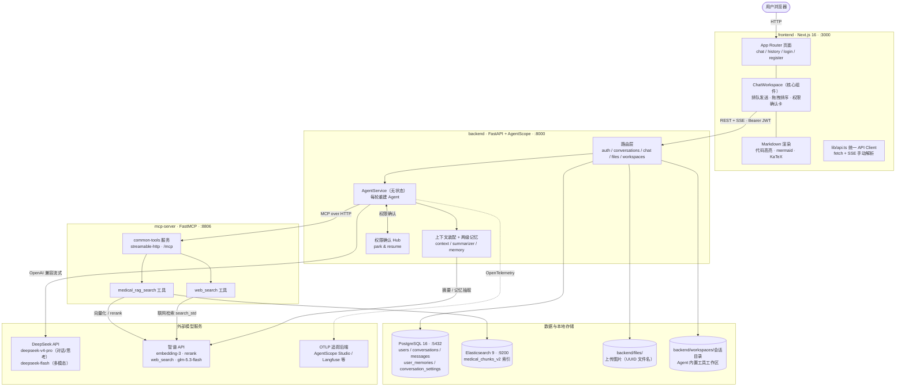
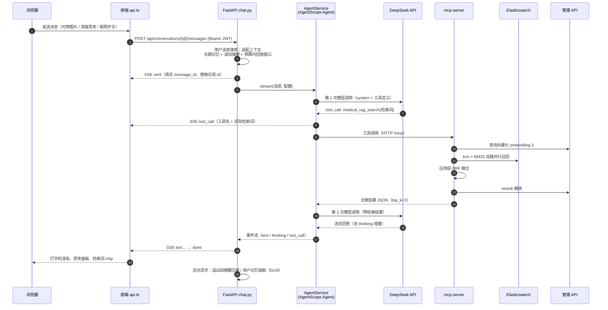
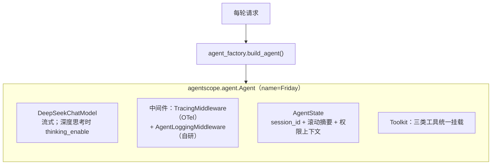
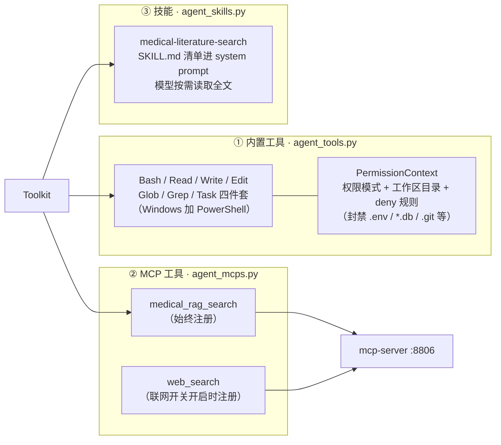
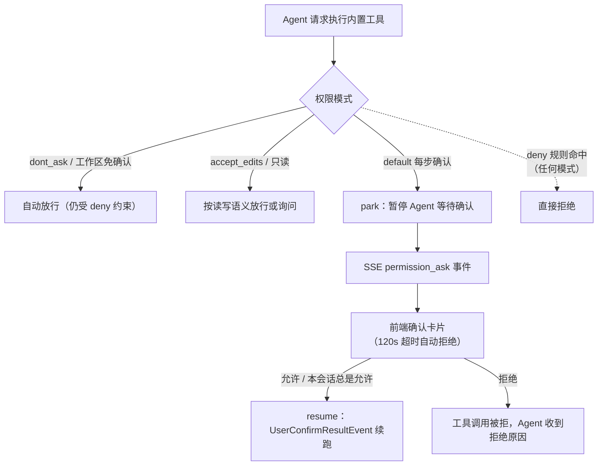
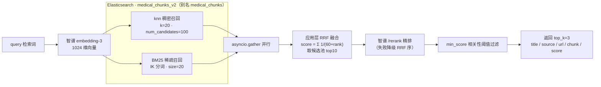
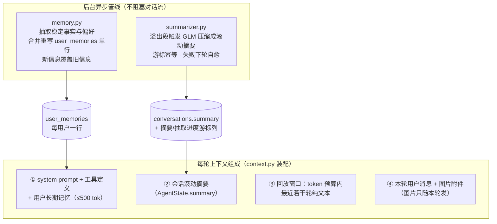
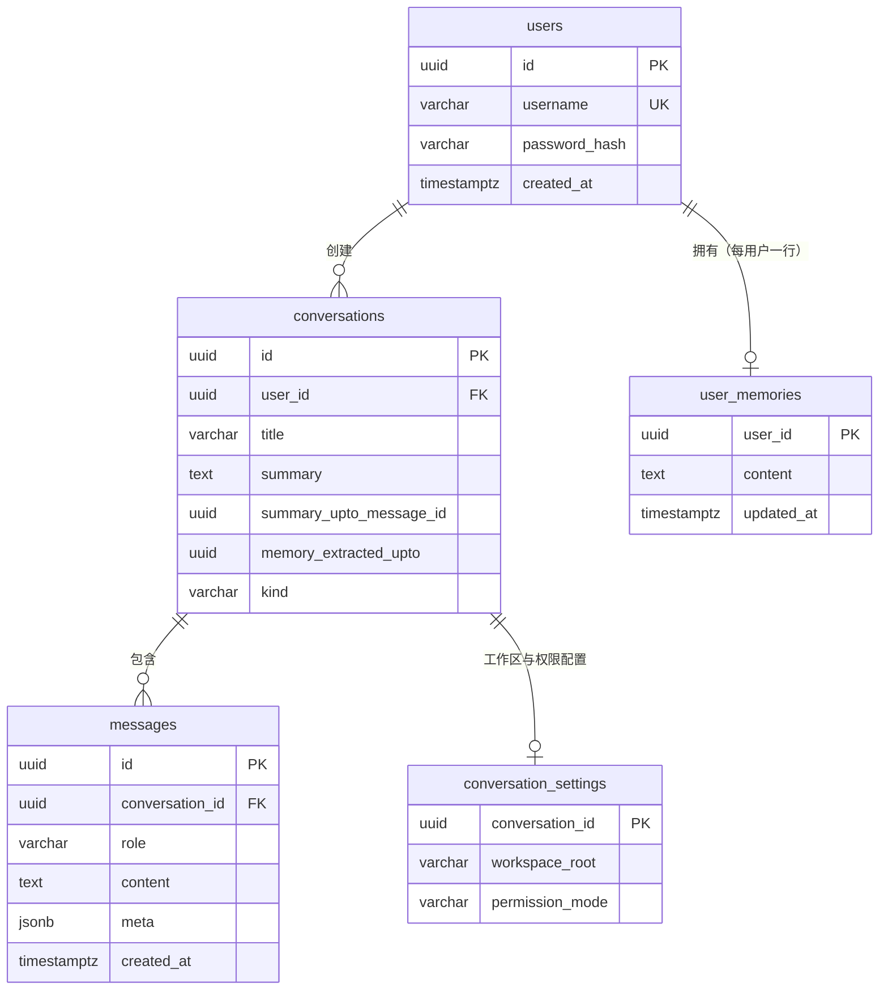
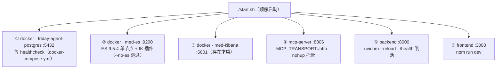
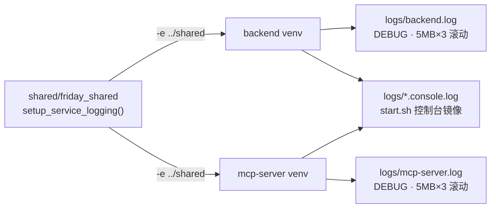

# Friday Agent 系统架构

> 本文档是**全局视角**的架构图与说明，覆盖 frontend / backend / mcp-server / shared 四个子项目、数据存储与外部服务。
> 后端内部实现细节（模块逐文件职责、SSE 协议字段、权限 deny 规则等）见 [`backend/ARCHITECTURE.md`](backend/ARCHITECTURE.md)；
> RAG 检索细节见 [`RAG.md`](RAG.md)，记忆系统设计见 [`MEMORY.md`](MEMORY.md)。

**一句话概括**：Next.js 前端 ↔ FastAPI 后端（AgentScope 编排 DeepSeek 模型）↔ FastMCP 工具服务（医学 RAG 混合检索 + 联网搜索），业务数据在 PostgreSQL，文献语料在 Elasticsearch，日志由 shared 包统一收敛到根目录 `logs/`。

---

## 一、系统总览（容器图）



**要点**

- 前后端唯一通道是 `frontend/src/lib/api.ts`：普通请求走 fetch JSON，流式对话用 `POST /api/conversations/{id}/messages` 以 fetch reader 手动解析 SSE（无 WebSocket）。
- 后端 Agent **每轮无状态重建**（`AgentService` + `AgentState`），会话状态全部外置到 PostgreSQL，跨用户串味、重启失忆从架构上消除。
- mcp-server 是独立进程、独立 venv，通过 MCP streamable-http 挂进 Agent 的 Toolkit；两个工具均声明 `readOnlyHint=True`，Agent 侧自动放行。
- 多模态路由：带图请求自动切 `deepseek-flash`（`settings.llm_vision_model`），纯文本走 `deepseek-v4-pro`。

---

## 二、目录结构

```
friday-agent/
├── backend/                  # FastAPI + AgentScope 2.0.10 后端（:8000）
│   ├── app/
│   │   ├── main.py           # 入口：5 组路由挂 /api、lifespan（日志/追踪/建表）
│   │   ├── config.py         # Pydantic Settings（llm_* 前缀环境变量）
│   │   ├── auth.py / auth_routes.py / captcha.py
│   │   ├── conversations.py / chat.py        # 会话 CRUD / SSE 流式对话
│   │   ├── agent.py                        # AgentService.stream()：无状态编排入口
│   │   ├── agent_factory.py                # build_agent()：组装 AgentScope Agent
│   │   ├── agent_tools.py / agent_mcps.py / agent_skills.py
│   │   │                                    # 工具三层：内置 / MCP / 技能
│   │   ├── agent_messages.py / agent_events.py / agent_logging.py
│   │   ├── context.py / summarizer.py / memory.py   # 上下文装配 / 两级记忆
│   │   ├── confirm.py                      # 权限确认 park & resume
│   │   ├── rag.py / websearch.py           # RAG 与联网的请求侧接线
│   │   ├── files.py / workspace_picker.py
│   │   ├── models.py / schemas.py / db.py  # SQLAlchemy 2.0 async ORM
│   │   └── tracing.py                      # OpenTelemetry 初始化
│   ├── skills/medical-literature-search/   # AgentScope 技能（SKILL.md）
│   ├── scripts/               # eval_agent / cleanup_files / es 索引 mapping
│   ├── tests/                 # 纯函数单测（pytest）
│   ├── files/                 # 上传图片（运行时）
│   ├── workspaces/            # 每会话工作区（运行时）
│   └── ARCHITECTURE.md        # 后端内部架构文档（深入细节看这里）
├── frontend/                  # Next.js 16 + React 19 前端（:3000）
│   └── src/
│       ├── app/               # App Router：(main)/chat、history + login/register
│       ├── components/        # ChatWorkspace / Shell / Markdown / AuthPage…
│       ├── lib/api.ts         # 唯一后端 API client（含 SSE 解析）
│       └── store/             # Zustand：登录态 / UI 状态
├── mcp-server/                # FastMCP 公共工具服务（:8806）
│   ├── app/
│   │   ├── server.py          # FastMCP("common-tools")
│   │   ├── tools/rag_search.py / web_search.py
│   │   └── auth.py            # http 模式静态 Bearer token 校验
│   └── scripts/               # eval_rag / smoke_test
├── shared/                    # friday_shared 包：统一日志（纯 stdlib 零依赖）
│   └── friday_shared/logging_setup.py
├── logs/                      # 全仓统一日志目录（backend.log / mcp-server.log…）
├── docker-compose.yml         # 仅 PostgreSQL；ES/Kibana 由 start.sh 独立管理
├── start.sh / stop.sh         # 一键启停（容器 + MCP + 后端 + 前端）
└── README.md / RAG.md / MEMORY.md
```

---

## 三、核心链路：一次流式对话（时序图）



**SSE 事件协议**（完整字段见 [`backend/ARCHITECTURE.md`](backend/ARCHITECTURE.md) §4.2）：

| type | 说明 |
| --- | --- |
| `sent` | 流首：用户消息已落库的真实 id |
| `text` / `thinking` | 正文 / 思考过程增量（分离推送，前端可折叠） |
| `tool_call` | 工具调用完成，含工具名与实际检索词 |
| `permission_ask` | 内置工具待确认（park，前端弹确认卡） |
| `error` / `done` | 出错 / 本轮结束 |

---

## 四、Agent 编排与工具体系

### 4.1 每轮构建（无状态）



Agent 进程内零跨请求状态：会话记忆在数据库，权限模式等会话级配置在 `conversation_settings` 表，每轮读出重建。

### 4.2 工具三层组装



调用与否完全由模型读 system prompt 与工具定义自主决策，后端只做**门控**（注册哪些工具）与**权限校验**（是否放行执行）。

### 4.3 权限确认链路（park & resume）



---

## 五、RAG 医学文献检索链路

实现位于 `mcp-server/app/tools/rag_search.py`，由 backend 经 MCP 调用。



- ES 服务端 RRF retriever 是付费功能，故在客户端应用层做融合（数学等价）。
- 索引契约：`chunk_text`（ik_max_word 索引 / ik_smart 检索）+ `embedding`（dense_vector 1024 维 cosine），mapping 存档于 `backend/scripts/es/medical_chunks_v2.mapping.json`。
- 联网搜索 `web_search` 是并列的另一个 MCP 工具：直连智谱 `/web_search` API（`search_std` 引擎）。

---

## 六、两级记忆系统



两条管线共用「每会话锁 + 进度游标 + 失败自愈」模式，均使用 GLM（glm-5.3-flash）执行，互不阻塞对话主流程。

---

## 七、数据模型



- `messages.meta`（JSONB）记录 `thinking` / `toolCalls`（工具名 + 检索词）/ `attachments`（图片文件名），工具调用可追溯、刷新不丢。
- 建表策略：启动时 `create_all` + 对已有表幂等 `ALTER TABLE … ADD COLUMN IF NOT EXISTS`（未引入 Alembic）。
- 图片本体存 `backend/files/`（32 位随机名），库里只存文件名；历史轮次回放为 `[图片]` 占位。

---

## 八、部署与运维拓扑



| 服务 | 端口 | 进程/容器 | 说明 |
| --- | --- | --- | --- |
| 前端 Next.js | 3000 | start.sh nohup | App Router + Turbopack dev |
| 后端 FastAPI | 8000 | start.sh nohup | `/api` 前缀 + `/health`，CORS 白名单前端 |
| mcp-server | 8806 | start.sh nohup | streamable-http `/mcp`，可选 Bearer token |
| PostgreSQL | 5432 | docker compose | 业务库 `friday_agent` |
| Elasticsearch | 9200 | docker（独立管理） | https + basic auth，自签证书 |
| Kibana | 5601 | docker（可选） | ES 观测 |

**统一日志**：`shared/friday_shared`（纯 stdlib、零第三方依赖）由 backend 与 mcp-server 的 requirements 以 `-e ../shared` 可编辑安装，各自 venv 一份：



- PID 文件与导入预检输出在 `.run/`；`./stop.sh` 按「先停消费方再停 MCP」顺序回收进程，容器 stop 但保留数据卷。
- start.sh 按 requirements 文件哈希幂等安装依赖，在 main（AgentScope 栈）与 feature 分支（LangGraph 栈）间切换后重跑即可自动升降级。
- 可观测：`TRACING_ENABLED=true` 时 `TracingMiddleware` 产出 OpenTelemetry GenAI 语义约定 span，经 OTLP 上报 AgentScope Studio 或任意兼容后端（如 Langfuse）；未开启时自动短路，近乎零开销。

---

## 九、技术栈速览

| 层 | 技术 |
| --- | --- |
| 前端 | Next.js 16（App Router）· React 19 · TypeScript · Ant Design 5 · Tailwind CSS 3 · Zustand · @dnd-kit · react-markdown / mermaid / KaTeX |
| 后端 | FastAPI 0.115 · Uvicorn · AgentScope 2.0.10（Agent / Toolkit / 事件流）· SQLAlchemy 2.0 async + asyncpg · Pydantic Settings · PyJWT · pwdlib[argon2] · Pillow · OpenTelemetry |
| MCP 工具服务 | FastMCP（streamable-http）· elasticsearch[async] 9.1 · httpx |
| 数据 | PostgreSQL 16（业务）· Elasticsearch 9.5 + IK（文献语料） |
| 模型 | DeepSeek（对话 / 思考 / 多模态）· 智谱 GLM（embedding / rerank / 联网搜索 / 摘要与记忆抽取） |

## 十、相关文档

| 文档 | 内容 |
| --- | --- |
| [`backend/ARCHITECTURE.md`](backend/ARCHITECTURE.md) | 后端内部架构：模块职责、启动流程、认证链路、SSE 协议、权限模型细节 |
| [`RAG.md`](RAG.md) | Elasticsearch 混合检索完整实现与索引契约 |
| [`MEMORY.md`](MEMORY.md) | 两级记忆系统的设计、代码地图与验收记录 |
| [`README.md`](README.md) | 功能清单、快速开始、环境变量、API 一览 |
| [`backend/README.md`](backend/README.md) / [`frontend/README.md`](frontend/README.md) | 子项目细节 |
